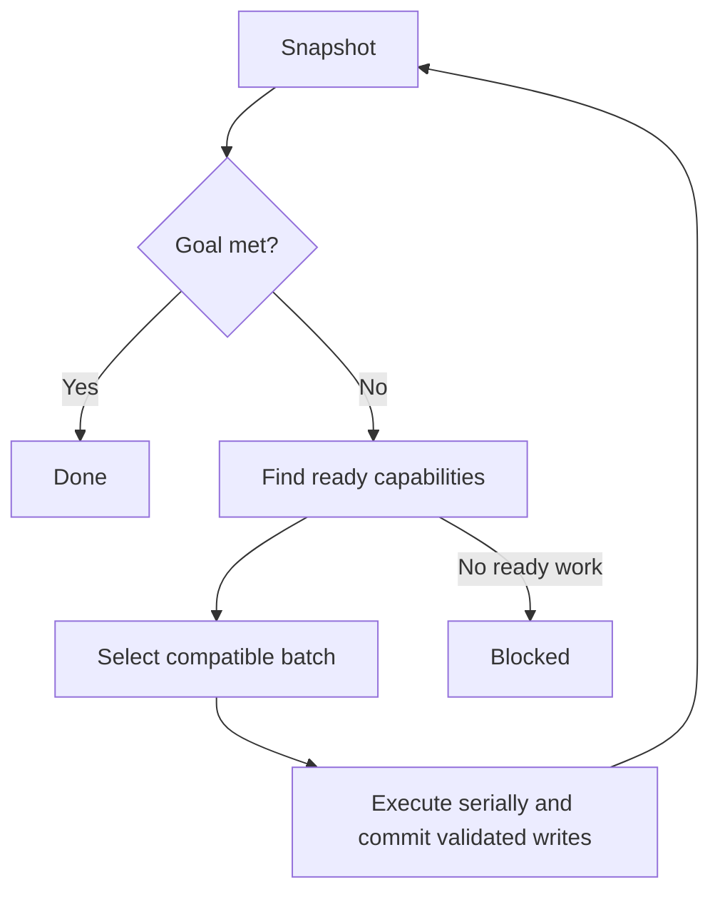

# Ranger — Evidence-First Execution Engine

> Experimental / pre-1.0. APIs and folder layout may change.

Ranger runs stateful workflows made of Python functions, models, tools and human checkpoints. Capabilities declare the state keys they need and the keys they produce. The engine schedules ready capabilities, checks a goal and records execution evidence in SQLite for inspection and comparison.

## Installation

Python 3.11 or newer is required. Install from a clone:

```bash
git clone https://github.com/skishore23/ranger.git
cd ranger
python -m pip install -e '.[dev]'
```

For a wheel installation, build the distribution and install it into your application's environment:

```bash
python -m build --wheel
python -m pip install dist/ranger-0.1.0-py3-none-any.whl
```

The distribution includes `core`, `ranger`, `agents`, `regions`, `topology` and `boot.py`. Jinja2 renders model prompts; jsonschema validates structured output. The examples below run offline with no keys or services. Save each Python block as a script and run it from any directory after installation.

## How execution works

State is a key–value map. `Snapshot` supports `snapshot[key]`, membership, `get`, `value`, `exists` and `data`. Reads export defensive copies: mutating a retrieved list cannot change the workspace or its history.

A capability becomes ready when its declared inputs exist and it has never consumed those input values, or those values change. A successful empty write or `SkipLLM` consumes its inputs so it does not spin until something changes. Missing outputs alone do not force reruns. Failed refreshes remain retryable.

The scheduler uses deterministic execution recency, compute priority and capability ID. Batches exclude write/write and cross-capability read/write conflicts. **Execution is serial**; compatible capabilities read the same selected snapshot. Each capability's complete merged write set is validated and published atomically. Earlier successful capability commits can remain when a later capability blocks.



`@step` describes pure computation; `@tool` describes actions with side effects; `@llm` runs a provider with optional JSON Schema validation; `@human` collects responses; `@goal` checks completion. These declarations help scheduling and policy enforcement. Python purity and isolation are caller responsibilities.

Capability IDs must be unique within an agent. Invalid IDs/declarations are rejected before execution, and every runner's writes are checked against its declared outputs. Enable `Agent(..., strict_contracts=True)` to reject undeclared state reads as well. Strict capability snapshots expose only declared inputs through `data` and `digest`; explicit undeclared access via indexing, `get`, `value`, `exists`, membership or the exported entry mapping raises `ContractViolation`. This also applies to model mappers, human callbacks, custom runners and postconditions. Presence checks count as reads: declare and seed optional inputs (for example with `None`). Goals still inspect the complete snapshot. Strict mode checks public state access, not arbitrary Python or external dependencies, and is opt-in for existing workflows.

## Hello, Ranger (no LLMs)

Save this as `hello.py`. It computes `c = (a + 1) * 2` and writes its trace to `.ranger/demo.db` relative to the current directory.

```python
from core.sdk import step, goal, Agent

@step(inputs=["a"], outputs=["b"])
def inc(state):
    return {"b": state["a"] + 1}

@step(inputs=["b"], outputs=["c"])
def double(state):
    return {"c": state["b"] * 2}

@goal(scope={"c"})
def done(state):
    return state.get("c") == 4

if __name__ == "__main__":
    agent = Agent([inc, double], strict_contracts=True, trace_path=".ranger/demo.db")
    result = agent.run(initial={"a": 1}, goal=done, max_steps=10)
    assert result.ok, result
    print("Final c:", result.final["c"])
    print("Run ID:", result.run_id)
```

## A Small ReAct-Style Agent

Save this as `react.py`. This injected offline provider reasons from the observation count and writes from the retrieved observation text. The plan includes the observations as an input so each query changes. The answer mapper raises `SkipLLM` until reasoning chooses `answer` and two observations exist. A single structured output stores the whole response dictionary, so read the decision as `state["thought"]["thought"]`.

```python
import json
from core.sdk import step, tool, llm, goal, Agent
from core.runners.llm_runner import SkipLLM

class OfflineProvider:
    def generate(self, *, system=None, prompt, model, temperature=None,
                 max_tokens=None, schema=None):
        request = json.loads(prompt)
        observations = request["obs"]
        if request["kind"] == "reason":
            return json.dumps({"thought": "search" if len(observations) < 2 else "answer"})
        assert len(observations) == 2
        return json.dumps({
            "text": " ".join(item["snippet"] for item in observations),
            "citations": [item["source"] for item in observations],
        })

provider = OfflineProvider()

@llm(inputs=["question", "obs"], outputs=["thought"], provider=provider,
     model="offline", temperature=0.0, max_tokens=200,
     template='{"kind":"reason","obs":{{ obs | tojson }}}',
     schema={"type": "object", "properties": {"thought": {"enum": ["search", "answer"]}},
             "required": ["thought"]})
def think(state):
    pass  # The LLM runner uses the template and provider, not this body.

@step(inputs=["question", "thought", "obs"], outputs=["query"])
def plan(state):
    if state["thought"]["thought"] != "search":
        return {}
    return {"query": f"{state['question']} evidence {len(state['obs']) + 1}"}

@tool(inputs=["query", "thought", "obs"], outputs=["obs"])
def search(state):
    observations = state["obs"]
    if state["thought"]["thought"] != "search" or len(observations) >= 2:
        return {}
    fixtures = {
        "What is ReAct? evidence 1": {
            "source": "fixture-1", "snippet": "ReAct combines reasoning and acting."},
        "What is ReAct? evidence 2": {
            "source": "fixture-2", "snippet": "Observations inform the next reasoning step."},
    }
    return {"obs": observations + [fixtures[state["query"]]]}

def answer_inputs(state):
    if state["thought"]["thought"] != "answer" or len(state["obs"]) != 2:
        raise SkipLLM()
    return {"obs": state["obs"]}

@llm(inputs=["thought", "obs"], outputs=["answer.draft"], provider=provider,
     model="offline", max_tokens=300, map=answer_inputs,
     template='{"kind":"answer","obs":{{ obs | tojson }}}',
     schema={"type": "object", "properties": {
         "text": {"type": "string"},
         "citations": {"type": "array", "items": {"type": "string"}}},
         "required": ["text", "citations"]})
def write(state):
    pass

@goal(scope={"answer.draft"})
def answered(state):
    return "answer.draft" in state

if __name__ == "__main__":
    result = Agent([think, plan, search, write]).run(
        initial={"question": "What is ReAct?", "obs": []}, goal=answered, max_steps=30)
    assert result.ok, result
    assert len(result.final["obs"]) == 2
    assert result.final["thought"]["thought"] == "answer"
    assert result.final["answer.draft"]["citations"] == ["fixture-1", "fixture-2"]
    print(result.final["answer.draft"])
```

## Recording, replay and comparison

SDK `Agent` records every run by default in `.ranger/runs.db`; `trace_path=` selects another file and `trace=False` explicitly disables recording. `SolveResult.run_id` identifies a recorded run. Runtime agents record in their configured domain database, such as `repo_root/.ranger/deepresearch.db`. Low-level `Engine` defaults to nonrecording. Creating runtimes and visualizing them preserves existing databases; purge is an explicit opt-in.

Execution logs include initial state, ordered capability statuses/timings, committed writes, snapshots, goal checks and terminal outcomes. Replay reconstructs recorded state without calling models, tools, goals or human handlers. It does not rerun side effects or verify current code. Omit `--run-id` to select the latest run:

```bash
python hello.py
ranger replay .ranger/demo.db --json
ranger scenario .ranger/demo.db --json
ranger explain .ranger/demo.db
ranger explain .ranger/demo.db --run-id RUN_ID --json
# Use the printed IDs from two executions of hello.py:
ranger replay .ranger/demo.db --run-id RUN_ID --json
ranger diff .ranger/demo.db --left FIRST_RUN_ID --right SECOND_RUN_ID --json
```

Replay structurally validates evidence and rejects malformed records. Scenario success requires a recorded successful outcome; missing, failed and incomplete evidence cannot certify success. Legacy testwriter scenarios require successful execution plus actual sufficient coverage. SQLite logs remain local mutable data, not tamper-proof audit records. Recording errors raise visibly, but cannot undo prior external effects or already published workspace writes.

`ranger explain` shows the decisions recorded before each attempted batch: selected capabilities, missing inputs, unchanged inputs, conflicts with selected capabilities, pending retries and execution limits. It reads evidence without importing or rerunning workflow code. Older logs remain replayable but cannot supply decisions they never recorded; an initially satisfied goal also has no schedule. Scheduling records contain capability/key names and reasons, not input values. For runs with `trace=False`, terminal scheduling blockers include the latest report in `result.blocker.details`.

Boolean goals remain supported. A goal can optionally return `GoalCheck(met=False, unmet=["tests must pass", "coverage target must be reached"])` from `core.sdk` to record named unmet requirements; use `GoalCheck(met=True)` once they hold. The engine also records missing scope keys. These messages are supplied by the application; Ranger does not infer an explanation from arbitrary Python predicates.

Trace state must use JSON `null`/`None`, booleans, integers, finite floats, strings, lists and string-keyed dictionaries. Tuples, sets, custom objects, circular structures and nonfinite numbers raise rather than being converted to strings. Use `trace=False` when your application needs arbitrary Python state.

`ranger trace` inspects memory atoms, which are separate from SDK execution events. For example, after running a reference agent: `ranger trace .ranger/testwriter.db --domain testwriter --limit 20`.

## Shared field contracts

Pass `field_contracts={"field": FieldContract(schema=..., allowed_writers=["capability-id"], allow_initial=True)}` to `Agent` to validate both initial values and final merged updates against shared JSON Schemas. A supplied map defines the complete allowed field set; writer IDs control updates, while `allow_initial` separately controls seeds. Omit the map to retain existing behavior. This complements strict read contracts and evidence binding. See the [executable example and field contract](docs/FIELD_CONTRACTS.md).

## State transitions and history

Pass `transition_checks={"name": callback}` to enforce rules against `(previous, proposed)` snapshots before publishing an update. The proposal includes all untouched fields and final merged writes, so a check can require that approval evidence matches the candidate being published. Return a Boolean or `GoalCheck`; failure rejects the entire update. Initial state remains a baseline and empty writes skip checks. Omit the option to preserve existing behavior.

Recorded attempts now include versioned transition records: writer, declared input versions/fingerprints, accepted before/after values, check outcomes and rejected attempts. `ranger trajectory DB` displays the trajectory; `ranger history DB FIELD --json` queries accepted versions and associated rejections. Both accept `--run-id` and inspect evidence without rerunning code. Older logs remain readable with explicitly derived legacy history. See the [executable approval example and transition contract](docs/TRANSITIONS.md).

## Reusable validation evidence

`core.evidence` supplies `capture_binding`, `bind_evidence`, `check_binding` and `check_evidence`. Capture declared JSON inputs/file bytes before validation, attach the actual Boolean outcome, and require a matching current binding at acceptance. Checks return `GoalCheck` with unmet requirements. Missing/malformed evidence, changed inputs, changed file inventory or context, and a different validator cannot approve a candidate. The application supplies the current dependency list independently. See the [complete example and binding contract](docs/EVIDENCE_BINDING.md).

The testwriter uses this facility for both pytest and coverage, covering its source module, generated tests, target/attempt and validation settings. Its final goal rechecks evidence even when terminal success was cached. Bindings are content fingerprints with explicit scope; they do not infer dependencies or authenticate validator outcomes.

## Budgets and policy boundaries

Defaults are **200000 estimated model token units, 300000 milliseconds and 120 capability attempts**. `max_steps` separately limits serial batches (default 60). Calls count capability attempts, including retries. Explicit zero and smaller limits remain authoritative; an already satisfied initial goal can succeed without executing capabilities.

Each model request reserves the full serialized request's UTF-8 byte count plus 64 framing units and its requested completion limit (1500 when omitted). Remaining allowance clamps completion; reservations are not refunded for shorter responses or failures. This conservative estimate does not measure provider billing. Custom providers must honor completion limits. Region adapters may additionally reserve their payload. Large documents or requests can exhaust a budget.

Elapsed time is checked before and after synchronous work and before state publication. A late result cannot commit successfully; the deadline cannot preempt an in-flight Python function, subprocess or network call, nor undo its side effects.

Registered guards check complete model requests and action inputs. Errors, failed repairs and schema-changing repairs block protected execution. `@llm` and built-in model adapters use this boundary. Python steps calling a custom provider directly must use `core.execution.generate_with_policy(provider, ...)`. Guards are policy checks; they do not isolate arbitrary Python.

## Scaffold and reference agents

The CLI creates an offline starter and its smoke test in your project:

```bash
ranger init demo-agent
python -m pytest tests/test_demo_agent.py -q
python -m agents.demo_agent.agent
```

For larger workflows, `core.plan.plan` and `action` compose declared capabilities. `agents.common.runtime.AgentRuntime` configures memory, budgets, plans, guards and scenario helpers. See the [agent guide](docs/AGENT_GUIDE.md), [API reference](docs/API_REFERENCE.md) and [provider guide](docs/LLM_PROVIDER_GUIDE.md).

The testwriter executes generated tests with the caller's privileges. It validates the whole requested file batch beneath `repo_root/tests`, rejecting traversal, symlink escapes, invalid path types and ancestor conflicts before writing. This preflight is not a filesystem transaction against arbitrary I/O failures or concurrent external symlink changes. Progress binds each target and attempt to actual pytest and coverage results; disabled execution or missing coverage cannot certify passing tests.

Deep research uses retrieved source IDs/URLs in notes and citations, rejects short/repeated output and requires distinct retrieved citations. These mechanical checks do not prove factual accuracy or that a citation supports a claim. Required review needs an explicit `approve`; blank or missing status cannot publish a report. Read the [research architecture](agents/deep_research/ARCHITECTURE.md) for its remaining limits. Reference agents normally use external services; tests inject offline providers and retrieval fixtures.

## Visualization and development

Install `.[viz]` and the Graphviz system executable to render capability graphs:

```bash
python -m pip install -e '.[viz]'
ranger visualize agents.testwriter.agent:TestWriterAgent --repo . --format svg
ranger visualize agents.deep_research.agent:DeepResearchAgent --repo . --format svg
```

`python -m pytest -q` runs the offline suite, including real clean wheel/editable installs, literal examples, generated scaffolds and replay/diff CLI commands outside the checkout. Package downloads during installation require an index or populated cache; workflow execution makes no live model or Firecrawl calls. Optional Graphviz tests skip when unavailable. CI runs Python 3.11, 3.12, 3.13 and 3.14.

The repository layers are `core/` (state, admission, execution and evidence), `ranger/` (CLI, scaffolding and scenario tools), `agents/` (runtime and reference agents), `regions/` (memory/provider/guard bindings), and `topology/` (planning/context adapters). All are included deliberately in the distribution. The [runtime architecture](docs/ARCHITECTURE.md) describes module ownership, dependency direction and the publication/replay paths.
