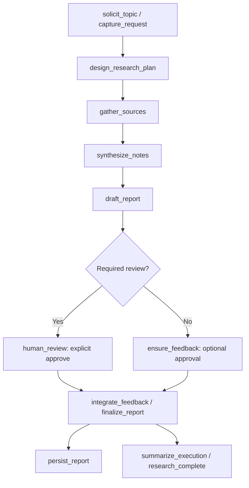

# Deep Research Agent Architecture

The research agent composes topic intake, planning, retrieval, notes, drafting, review and publication as Ranger capabilities. The engine executes them serially from their declared dependencies. Configured length/citation targets describe requested output, not guaranteed quality or successful completion within every budget.

## Pipeline



1. Topic intake collects interactive input when needed and persists the normalized request/config/directives.
2. Planning produces an outline, questions and queries through a configured provider with schema validation.
3. Retrieval uses Firecrawl v1 `limit`, `scrapeOptions.formats=['markdown']` and response `data` with `description`/`markdown`. Provider `success=false` and HTTP failures surface; no synthetic source fallback is supplied. Retrieved URL identities generate deterministic source IDs.
4. Notes prompts carry retrieved source IDs, URLs and titles. Statistics must reference retrieved source IDs or URLs. Model/provider failures do not certify successful synthesis.
5. Draft prompts include retrieved sources and request exact ID/URL references. Citations require distinct retrieved URLs and labels, matching source IDs and configured counts. Invented/unretrieved URLs or mismatched IDs are rejected.
6. Draft/final validation counts distinct meaningful sentences of at least 30 characters toward length and detects exact repeated normalized sentences/lines, including short filler. Short or overly repeated output blocks; content/citations are never padded to pass.
7. Required review excludes the optional auto-approval writer. `human_review` declares config as an initial dependency. Its status select field uses `default_first_option=False`; missing/blank/invalid status and `revise` cannot approve publication. Explicit `approve` can have empty comments. Noninteractive missing feedback blocks with `human_feedback_required` and produces no published report. Optional review may explicitly auto-approve.
8. Finalization rechecks content/citations/review and can publish Markdown. Summary records character/page estimates and citation counts for goal checks.

These are mechanical length/identity/duplication checks. They do not prove factual accuracy, semantic relevance, claim-by-claim citation support or completed editorial review. Human review remains necessary for those judgments; a model can still misrepresent a retrieved source.

## Evidence and budgets

By default memory atoms and ordered execution events share `repo_root/.ranger/deepresearch.db`. Effective memory path/domain overrides also control trace and scenario selection. Constructor/visualization preserves prior data; explicit purge is opt-in. Schemas include request, plan, source, notes, report and citation atoms. Execution logs capture initial state, capability status/timing, committed snapshots, goal checks and terminal outcomes under unique run IDs.

`agent.scenario_report(run_id=...)`, `ranger scenario DB --run-id ID --json`, `ranger replay DB --run-id ID --json` and `ranger diff DB --left ID --right ID --json` inspect real execution evidence. Replay reconstructs state without rerunning provider, retrieval, human or filesystem actions. Incomplete/failed/missing evidence cannot certify success. Structural validation does not make a mutable local SQLite database tamper-proof. Recorder failure cannot undo an earlier external side effect.

Default limits are 200000 estimated model token units, 300000 ms and 120 capability attempts; explicit supplied budgets take precedence. Model requests reserve complete serialized UTF-8 request bytes + 64 framing units + completion ceiling, without refunds. Region adapters may also reserve their payload. Large retrieved documents/default requests can exhaust explicit caps; budgets are never silently replenished. Synchronous deadlines check before/after work but cannot interrupt an in-flight API or filesystem call.

Direct/custom provider calls use `core.execution.generate_with_policy`. HTTP/filesystem capabilities cross registered action guards before side effects. Guards are policy checks rather than Python isolation. Offline tests inject model providers and retrieved source fixtures, use distinct report content and matching citations, and exercise public success and required-review failure without paid calls.

## Human interaction and visualization

HumanRunner collects CLI fields with TTY stdin; interactive fields may use `RANGER_FIELD_<NAME>` overrides. Noninteractive execution captures no responses. Callbacks validate approval rather than relying on generic form defaults.

Optional visualization requires the Python `graphviz` extra and Graphviz system executable:

```bash
python -m pip install -e '.[viz]'
ranger visualize agents.deep_research.agent:DeepResearchAgent --repo . --format svg
```

`agent.py` builds the runtime/plan; `capabilities.py` implements stages; `firecrawl.py` handles retrieval; `memory_bridge.py` persists atoms; `types.py` defines configuration. See the root README and API reference for installable offline examples and execution limits.
